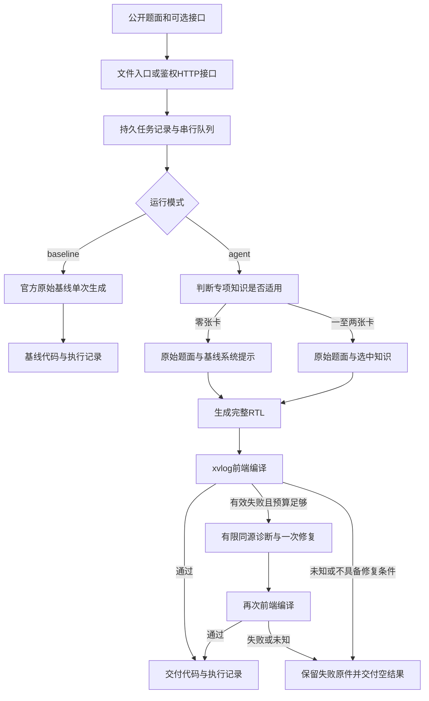

# RTL Agent 设计报告

## 1. 方案概述

本方案将自然语言电路需求转换为完整的 Verilog/SystemVerilog 模块。模型和编译工具运行在本地比赛实例中，对外提供标准文件入口和异步投题接口。一次任务从接题、排队、生成到交付共用900秒预算。

设计目标是在同一模型的直接生成基线上，利用少量、确实适用的知识和编译反馈减少可避免的错误。知识卡并不是每道题的必选项：一般的位连接、布尔运算和编码题可以不使用卡片，直接按题面生成代码。只有真实执行过且证据完整的编译失败，才开放一次修复。

当前交付包含题目读取、可选知识路由、同模型推理、前端编译、有限修复、任务队列和结果记录。尚未形成最终版本在完整官方开发题库上的正增益证明。开发题上的通过、服务在线和正式比赛得分分别报告，不将它们合并为一个“已通过”的结论。

## 2. 总体架构



从使用者角度，只需交付题面或调用接口。内部将接题、模型生成、工具检查和独立判分分开。文件入口与HTTP入口共享同一常驻引擎，模型只加载一份，任务串行执行。HTTP服务负责鉴权和任务查询，不另起一套解题模型。

这种分层解决两个问题。第一，终端读文件不应依赖公网隧道是否可用。第二，任务已经开始之后，即使客户端断开或适配器重启，也不能把原任务当成“没有发生”而再次生成。

## 3. 模型与推理栈

### 3.1 最终配置

| 项目 | 配置 |
| --- | --- |
| 基础模型 | Qwen/Qwen3.6-35B-A3B |
| 量化仓库 | unsloth/Qwen3.6-35B-A3B-GGUF |
| 权重版本 | a483e9e6cbd595906af30beda3187c2663a1118c |
| 量化与文件 | UD-Q4_K_M；Qwen3.6-35B-A3B-UD-Q4_K_M.gguf |
| 权重大小 | 22,134,528,992字节 |
| 权重SHA-256 | ac0e2c1189e055faa36eff361580e79c5bd6f8e76bffb4ce547f167d53e31a61 |
| 后端 | llama.cpp b1-f114f91，ROCm |
| 上下文 | 32768 token；不使用RoPE外推 |
| 生成参数 | temperature=0、top_p=1、enable_thinking=true |
| 输出上限 | 路由4096，首稿及修复最多16384；按实际分词和剩余时间夹紧 |
| 并发 | 单模型、单槽、串行任务 |
| 微调、蒸馏与辅助模型 | 均无 |

推理启动参数包含 `-c 32768 -np 1 -ngl 999 -fa on -ctk q8_0 -ctv q8_0 --jinja --no-context-shift --reasoning-format deepseek --fit off`。准确命令、后端二进制SHA、模板SHA和属性约束保存在 `model/model-runtime-lock.json`，权重索引在 `model/models.lock.json`。

选择这一配置的实际依据是已有ROCm后端、量化权重和模板能被同一套运行记录绑定，使方案与基线共享实际推理服务。本报告没有完整的多模型同条件对照，因此不根据早期不同模型、上下文或时间预算的结果给候选模型排序。

### 3.2 资源观测

`manifest.json`记录了10月30日22:52的一次同权重加载后空闲观测：22.992 GB，约22991556608字节。10月30日晚新服务的外部健康回执另记录22.622 GB。两者来自不同会话，不是同一测量时刻。

实例可见物理显存为48 GiB。这些数据只说明已加载服务的空闲占用，不能证明生成峰值不超过32 GB，也不能当作在物理32 GB卡上的验收。干净环境重建和完整峰值测量仍没有完成。

### 3.3 同模型基线

`baseline.py`和`run_baseline.sh`保留赛事方原始字节。基线直接使用公开题面进行一次生成，不调用知识卡或编译修复。Agent与基线共享权重、后端、模板、上下文和thinking设置；Agent额外执行路由、编译检查以及可能的修复，因此总调用数、时间分配和执行代价并不相同。

## 4. 智能体设计

### 4.1 公开输入与知识路由

正式输入只读取 `prompt.txt` 和可选的 `interface.txt`。接口已写在题面中时，不要求另建接口文件。程序将这两份公开内容生成快照并绑定SHA；不枚举或读取输入目录中的参考实现、测试台和评分材料。

路由器根据公开条件和知识目录选择零至两张叶卡，不按题号选择。存在直接相关的专项机制时，求解消息包含ROOT总则和选中叶卡；选择空列表时，只使用基线的系统提示、原始题面和接口，不加入ROOT、叶卡或路由短答。

引用是否逐字对应题面单独审计。引用不精确不能直接证明选错知识，结构合法也不能证明代码正确。公开题面始终优先于路由器的简短概括。

### 4.2 控制流与失败处理

每题最多三次模型尝试：一次路由、一次首稿、至多一次有效编译失败修复。路由回复已经确认正常关闭，但正文为空或结构不可用时，可以进入直接解题分支；传输关闭未知、配置校验失败或时间耗尽时则停止，不能以“兜底”为名再发请求。

首稿必须有完整RTL并符合源码策略，才进入编译。目前策略只接受一个大小写精确为 `TopModule` 的模块。模块名称不符、多模块或其他策略拒绝属于交付限制，不包装成编译失败以获取修复机会。

修复需要同时核对完整失败RTL、实际写入的DUT、编译结果、步骤记录、有限诊断、当前公开输入以及进程关闭记录。没有可选中的编译通过稿时交付空结果；失败候选和原始响应继续保留，不能把保存下来的失败文件当成成功答案。

### 4.3 时间、上下文与记录

900秒预算包含输入读取、排队、分词、推理、工具和发布。路由窗口最多180秒；实际输出上限还受剩余时间和上下文约束。消息经真实模板分词后，满足输入token数、输出上限和128 token余量之和不超过32768，不裁剪题面来凑预算。

修复消息只包含公开要求、完整失败代码和能定位到DUT的有限编译诊断，不包含整段工具日志、隐藏测试、历史分数或完整思考文本。请求发出前登记，结果与原始证据分别保存；已开始但结果未知的请求不自动重放。

### 4.4 自我验证的能力边界

正式解题端只有xvlog前端编译检查，没有逐题测试台，也没有自动生成并验证一套行为参考模型。编译通过只排除了部分语法和前端问题，不能证明端口语义、时序行为、仿真或综合正确。当前最大的能力缺口仍是从“可编译”到“功能符合题意”的验证，而不是继续增加路由解释文字。

## 5. 技能包与优化过程

### 5.1 知识内容

| 知识叶 | 关注的核心问题 | 适用条件 |
| --- | --- | --- |
| edge_state | 同步与异步更新、旧值与下一状态、同一拍采样 | 题面明确涉及边沿或状态采样 |
| event_history | 事件检测、历史值、同步脉冲保持 | 输出依赖此前周期或事件发生时刻 |
| lifecycle | 启动、活动、结束、取消和独立副作用 | 题面规定任务生命周期和优先级 |
| handshake | valid/ready、背压、未接收时保持状态 | 数据是否被接受由握手决定 |
| rolling_window | 索引、边界、缓存和移位顺序 | 窗口或缓存更新影响后续读出 |
| numeric_range | 符号扩展、先运算后截断、溢出和饱和 | 数值范围是功能约束的一部分 |

卡片内容由 `skill/prompt-inputs.lock.json` 固定。它们描述可复用原则，不按题号保存答案。普通位连接或布尔运算不能仅因为出现“输入、输出、位宽”等词就强制选卡。

### 5.2 从失败中提炼规则

开发测试同时改变表述、关键语义条款和位宽。同一语义改写用于观察表述稳定性；仅翻转旧值/新值等条款，用于观察语义敏感性；改变位宽用于暴露截断、扩展和边界错误。

V20的一对题只改变采旧值还是新值，模型却生成了逐字节相同的RTL，一题通过、一题失败。这表明简短分析说对并不代表代码落实。随后检查重点转向实际赋值位置、数据宽度和更新时刻，而不只看路由答案。

语法修复还暴露了交付问题：短编译错误并不保证修复会交出代码。后续将修复输入限制为完整失败源码和有限同源诊断，把空正文、工具未知与真正编译失败分开处理。

### 5.3 可选知识与直接求解

扩大到官方开发题库后，窄领域知识可能增加提示负担，额外路由还消耗时间。因此最终方案允许不选知识卡，并保留一条明确的直接求解路径。

四题验证中，位反转、布尔运算、奇偶校验三题均选择空列表，实际首稿消息与从官方基线原脚本重建的消息一致；结果均通过对应仿真。有符号饱和加法使用numeric_range，并在一次编译修复后通过。这证明两个分支可以实际运行，但不能证明所有范围外题都能被正确识别，也不能保证整体不低于基线。

## 6. 实测结果

### 6.1 范围与口径

以下结果全部来自开发阶段已有运行。概念变种之间相关，部分题此前已经见过，不属于未见题泛化测试。不同版本作为完整方案分别报告，不按题挑选不同版本的最佳答案。

官方判定器使用Vivado 2026.1、器件 `xczu3eg-sbva484-1-e` 和5 ns约束。L0/L1/L2/L3分别对应未通过、编译与展开通过、进一步仿真通过、进一步综合通过，系数为0、0.2、0.7、1.0。开发套件的“隐藏通过”不自动换算成官方L3。

### 6.2 已完成开发批次

| 批次 | 固定题数 / 实际模型调用 | 最终结果 | 必须保留的限制 |
| --- | --- | --- | --- |
| V20 概念变种 | 32 / 68 | 23隐藏通过；3功能失败、2编译失败、1工具未知、3空正文 | 23项中22项公测同时通过；4次修复均未交RTL |
| V23 扩展回归 | 32 / 66 | 29隐藏通过；2功能失败、1路由空正文 | 28项公测同时通过；旧19项正确只重新证实18项 |
| V24 收敛验证 | 32 / 66 | 29公测与隐藏同时通过；1功能失败、2编译失败 | V23的29项正确只重新证实27项；两次修复均未被采用 |
| V27 可选路由 | 4对 / 方案9、基线4 | 双方均4/4通过编译、展开与功能仿真 | 未执行综合，不能作为官方L3或完整题库增益 |

V23与V24总通过数都是29/32，但具体失败题发生变化：有两题修好，也有原正确题退步。因此不能仅凭相同或更高的总数宣布“上一版正确能力全部保留”。

V20的16个同义对有9对双过、3对一过一败、4对不完整或未知；V23为14对双过、1对一过一败、1对不完整；V24为13对双过、3对一过一败。各轮题集和干预不完全相同，这些数字用于发现不稳定现象，不作单因素因果结论。

### 6.3 四题配对结果与代价

| 题目 | 覆盖 | 选卡 | 方案 / 基线结果 | 方案 / 基线整链秒数 |
| --- | --- | --- | --- | --- |
| 8位反转 | 穷举256个输入 | 无 | 通过 / 通过 | 53.89 / 28.52 |
| 8位与、异或组合 | 4096组确定性组合 | 无 | 通过 / 通过 | 43.52 / 13.95 |
| 8位奇偶校验 | 穷举256个输入 | 无 | 通过 / 通过 | 49.27 / 13.10 |
| 5位有符号饱和加法 | 穷举1024组输入对 | numeric_range | 修复后通过 / 通过 | 191.79 / 165.92 |

三道直接求解题的RTL与基线除末尾换行外相同。方案的总耗时仍高出约25至36秒，路由自身约23.34、26.67、32.87秒；整链差值还包含其他开销，不能全部归因于路由。这次验证支持“可以不用知识卡”，不支持“已经取得正增益”。

### 6.4 全量开发队列的未完成部分

V26预先固定263题：官方开发题156、旧回归40、概念变种64、公开示例3。每题分别运行方案和原样官方基线，共计划526个生成作业。截止时实际生成350个作业，即175对；其余88题没有准入，仍保留在计划分母中。

独立评分计划包括参考实现、方案和基线，共789条记录。该评分后来取消，停止时记录672条，不是完整自然完成。672也不是672道题或672次通过，不能据此填出完整L0—L3分布。当前报告不报告该轮完整题集得分、归一化增益或最终版本全量胜率。

开发阶段已观测到方案在部分题上不如直接基线，说明小范围知识变种上的改进不足以代表全题库收益。可选路由是对此的改进方向；后续四题通过不能代替全量对照验证。

### 6.5 分数、采样与时间

完整分级数据齐全时，题集得分按各题系数的平均值计算，归一化增益为 `g=(S_agent-S_baseline)/(1-S_baseline)`；基线满分时另按官方定义处理。工具未知、坏题和未运行必须单列，并明确同一比较分母。本报告没有用不完整记录填零来伪造一个最终分数。

现有配对开发任务每模式只采样一次，没有足够重复样本计算pass@5；正式成绩由赛方评测给出。V20单题整链中位129.513秒、最长562.726秒；V24最长565.509秒。它们属于相应开发版本，不作为当前产品全题库耗时保证。

## 7. 复现说明与接口

### 7.1 环境与构建

源代码包含Dockerfile、模型锁、依赖声明、启动器、Agent、知识包和官方基线。基础镜像为Dockerfile指定的赛事镜像；环境需具备 `/opt/python/bin/python3`、Uvicorn、锁定的llama.cpp/ROCm运行库及Vivado 2026.1许可证。权重依据 `model/MODEL.md` 的公开revision和SHA提前准备，离线启动不下载。

在具备Docker及基础镜像访问权限的复现环境中，构建入口为：

```bash
docker build -t rtl-agent:1.0.5 .
```

这是一条源码提供的构建入口，不是已经完成干净环境Docker构建的实测记录。比赛实例现有环境的服务启动与外部鉴权已经验证，二者范围不同。

### 7.2 文件入口

```bash
bash serve/start.sh
bash run.sh /path/to/input /path/to/empty-output
bash run_baseline.sh /path/to/input /path/to/empty-baseline-output
```

题面放在输入目录的 `prompt.txt`，可选 `interface.txt`；答案为输出目录的 `solution.v`，执行记录为 `trace.jsonl`。方案与基线须串行运行。标准shell入口调用Python主体，文件解题不依赖公网隧道或赛事令牌。

### 7.3 公网投题接口

引擎就绪后执行 `bash serve/run_api.sh start`，HTTP适配器绑定 `127.0.0.1:7860`，由赛方隧道暴露该端口。令牌从 `FPGACHINA_TOKEN` 或私有文件读取，不存入仓库。

| 接口 | 行为 |
| --- | --- |
| `GET /v1/health` | 鉴权后返回就绪状态、rtl赛道、模型名与显存观测 |
| `POST /v1/solve` | 受理后立即返回202与job_id，支持agent和baseline |
| `GET /v1/jobs/<job_id>` | 返回queued/running/done及完成后的代码、trace和耗时 |

相同nonce对应相同任务时不重复解题；同nonce与不同请求冲突则拒绝。任务预算包含排队。服务状态与题目状态分别记录，health就绪不代表某道题功能通过。

### 7.4 工具与状态目录

Vivado安装位置读取 `XILINX_VIVADO`，许可证由运行环境提供。EDA工作区使用本地临时盘，默认 `/var/tmp/eda`；题目和会话记录保存在仓库之外。引擎和客户端使用PID、启动时间和boot身份核对资源，避免把复用的PID当成原进程。

公开示例可以由 `python3 tools/demo.py` 运行，生成后再用官方判定器判分。自写题只有题面时能生成代码，但没有对应测试台就不能凭空取得功能分数。

### 7.5 当前发布的实际验证范围

10月30日晚完成模型加载、后台引擎和HTTP适配器启动，并从实例外部实际访问公网接口：无令牌401、错误令牌401、正确令牌200且ready=true、track=rtl，未知任务404。

该次发布没有发出新的解题POST或执行EDA评分。最终分发版的完整解题、取消、重启、从零构建及峰值显存验收尚未完成；历史开发实验也不能自动替代这些验收。此处记录已取得的证据，不把服务可达写成功能测评通过。

## 8. 失败分析

### 8.1 具体问题

| 现象 | 证据与原因判断 | 对方案的影响 |
| --- | --- | --- |
| 短答正确，代码没有翻转语义 | V20 case19/20只改变旧值/新值采样要求，RTL却逐字节相同；新值题隐藏194处不匹配 | 不能以路由概括代替代码行为验证 |
| 同步脉冲消失 | V20 case08把结束脉冲组合地依赖active，活动状态在边沿清零后脉冲也消失 | 必须明确脉冲产生和保持的时间 |
| 空闲取消阻断新任务 | V20 case21给空闲start额外增加了!cancel条件 | 生命周期优先级不能误伤独立动作 |
| 数学规则正确但语法交付失败 | V20出现 `5'sd-16` 等写法；V23一例改为合法负常量形式后通过 | 编译修复有价值，但交付并不稳定 |
| 能编译但位宽错误 | V24 case34未声明live_next位宽，工具接受隐式一位net，实际多位下一态被压缩 | 前端编译不是功能正确性证明 |
| 动态表达式写成声明初始化 | V23 case13在模块级logic声明中计算输入相关量，仿真出现未知值 | 要区分持续组合计算与一次初始化，不能一概否定合法局部初始化 |
| 模型耗满输出但没有正文 | V20三个首稿及四个修复达到输出上限，正文仍为空 | 不把空交付当网络问题再补发 |
| 宿主工具结果未知 | V20 case26有零失配日志，但截止传递缺口使公开工具流程未知 | 保留原未知，后续隐藏通过不倒改当时结果 |
| 文件入口只报通用HTTP错误 | 旧文件入口依赖暂停准入的测试API，隐藏了具体错误 | 当前实现拆出本地常驻引擎，文件入口不依赖隧道 |

### 8.2 尝试过但不足以解决问题的改进

增加路由输出预算可以使某些长回复完整交付，但不会自动修正RTL。V24有完整路由和完整首稿的32题，仍有三题失败；最终29/32与V23相同，且旧正确题存在退步。

增加通用实现提示也不等于有效自检。V24一次修复附带了源码绑定词法建议，但建议为空，没有指出未声明隐式net；本轮没有“建议定位问题并修复成功”的证据。

仅用相关开发题验证卡片会高估覆盖范围。当前允许空知识选择，减轻不适用规则的强制注入，但仍保留路由开销和误判风险。四题与基线持平不能证明任意新分布都不退步。

### 8.3 尚未解决的边界

正式接口缺少行为验证，源码策略对模块形式有限制；复杂题可能在路由、输出交付或时间预算上失败。未知工具状态会阻止交付，改善了记录可信度，却也可能降低完成率。更换后端、模板、权重或运行资源需重新核验，不能沿用旧环境的结论。

## 9. 实质贡献

1. **知识可选，而不是强制套用。** 三道范围外小题真实进入无卡分支并通过仿真；这验证了分支行为，尚未验证全量正收益。
2. **修复资格绑定真实失败证据。** 原始回复、失败RTL、实际DUT、诊断和资源关闭必须同源；V27一例有符号题经一次编译修复后通过，失败或未知不获得无限重试。
3. **用成对语义测试发现“会解释但不会实现”。** 旧值/新值同字节RTL和同步脉冲失效等实例，直接揭示了只看路由短答的不足。
4. **把使用接口与实验队列分离。** 文件与HTTP共用同一引擎，输入、生成、工具和交付各自保留记录；接口可达、代码可编译与正式功能分数不互相冒充。

## 10. 结论与展望

方案已经实现一套可选知识、有限编译修复和标准接题接口的本地RTL生成系统。开发结果显示，语法补救和知识使用方式能在具体场景起作用，但也显示了回归、空交付、工具未知和范围外题的额外开销。当前证据不足以宣称最终版本在完整题库上优于官方基线。

下一步最有价值的工作是扩大无卡与有卡的同条件对照，并在正式只给题面的条件下引入可靠的行为检查。其优先级高于继续堆叠提示词。任何新的收益结论都应同时报告原正确题保护、修好与改坏、工具未知、未运行和成本，不能只挑通过的样本。

## 11. 参考资料

- [官方参考仓库](https://gitee.com/Vickyiii/rtlagent2026)，文档快照 `fc8e26a5828b7222e9db439cee29128bcf4f8865`。
- [赛事接口契约](https://gitee.com/Vickyiii/rtlagent2026/blob/master/docs/API_CONTRACT.md)。
- [代码封存与仓库提交说明](https://gitee.com/Vickyiii/rtlagent2026/blob/master/docs/SUBMISSION.md)。
- [官方报告模板](https://gitee.com/Vickyiii/rtlagent2026/blob/master/REPORT_TEMPLATE.md)。
- [量化权重与固定版本](https://huggingface.co/unsloth/Qwen3.6-35B-A3B-GGUF/tree/a483e9e6cbd595906af30beda3187c2663a1118c)。
- 仓库内 `licenses/THIRD_PARTY.md`、`selftest/judge/PROVENANCE.md` 与 `model/MODEL.md`。

## 12. 大模型协作记录

### 12.1 所用工具与版本

| 模型或工具 | 版本 | 使用环节 |
| --- | --- | --- |
|  |  |  |

### 12.2 设计创新点的来源

### 12.3 采纳的建议与效果

### 12.4 错误建议与纠正过程

### 12.5 本人的验证与判别

## 13. 附录

### 13.1 关键代码位置

| 文件 | 作用 |
| --- | --- |
| `agent/formal_controller.py` | 题目快照、路由、首稿、编译修复、交付与预算 |
| `agent/prompt_builder.py`、`agent/route_adapter.py` | 公开消息组装、可选知识、路由结构与引用审计 |
| `agent/compiler_repair.py`、`agent/compiler_adapter.py` | 同源编译证据与有限修复输入 |
| `agent/generation_policy.py` | 统一模型声明、生成参数和原始基线校验 |
| `agent/service_entry.py`、`agent/service_start.py` | 常驻引擎与生命周期 |
| `agent/api_client.py`、`agent/public_api.py` | 文件入口和赛事异步HTTP适配 |
| `agent/formal_jobs.py` | 持久任务记录、nonce和串行占用 |
| `tools/grade.py`、`selftest/judge.py` | 生成以后的独立公开判分 |

### 13.2 结果使用边界

第6节是已有开发批次摘要，不是最终正式成绩。V26完整逐题分级表尚未形成，不以部分评分或不同版本赢家拼成一份完整结果。运行日志、隐藏测试和原始思考不随代码仓库公开；模型输入、源码与诊断的绑定由各次运行原件保留。
